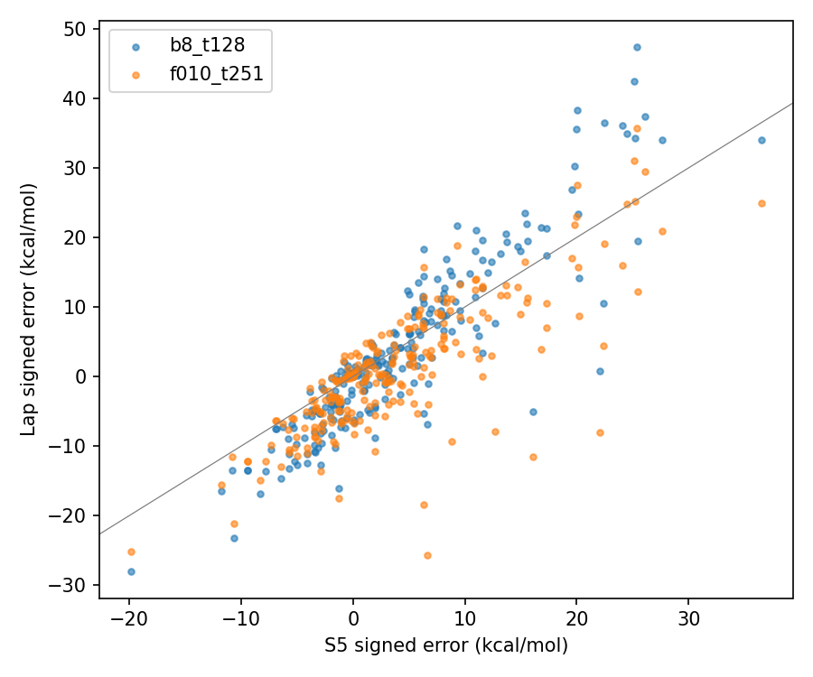
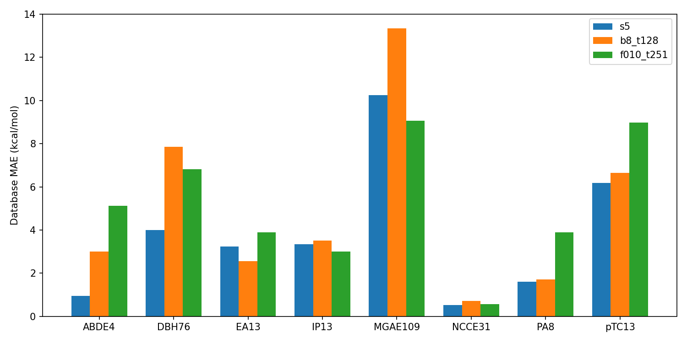
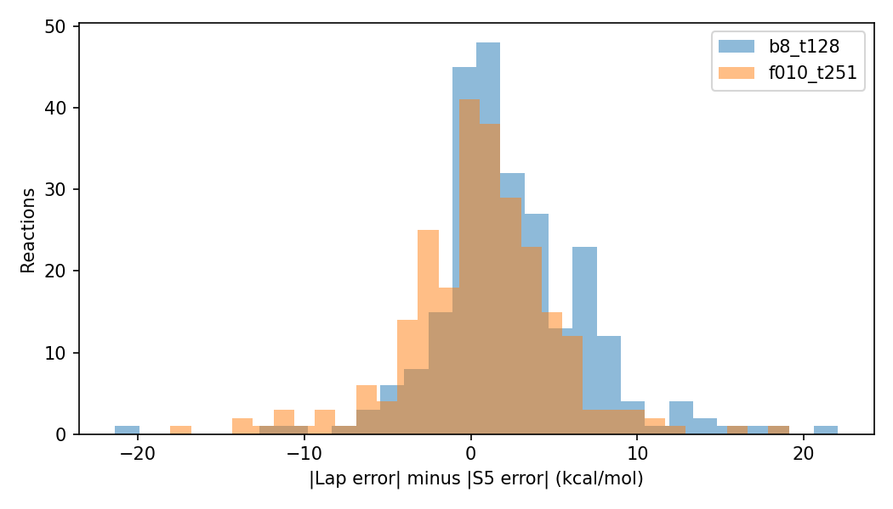
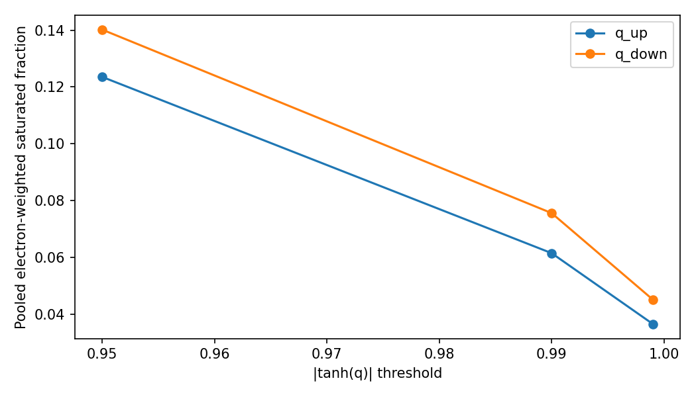
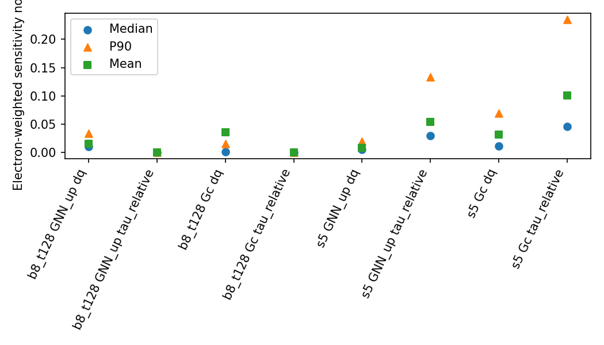
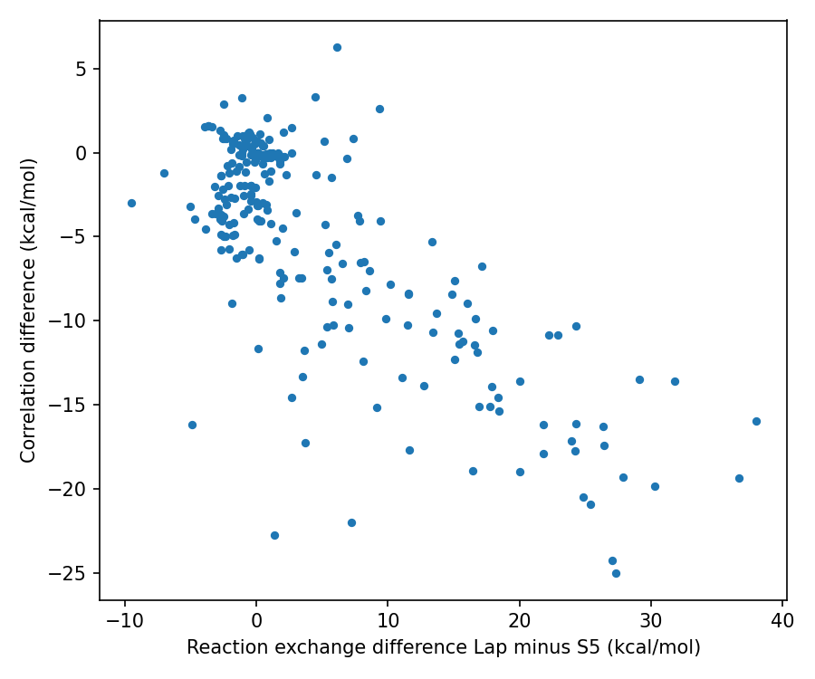
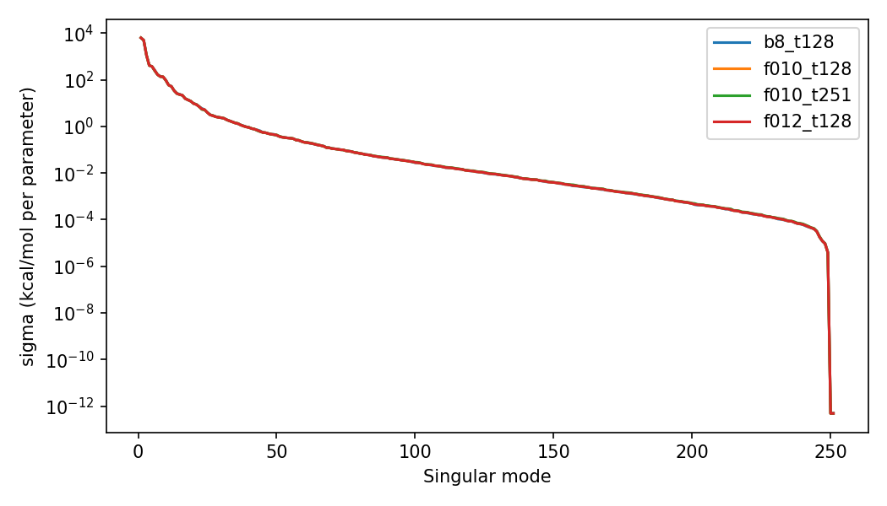
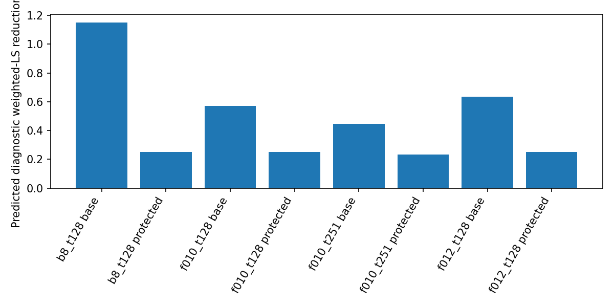
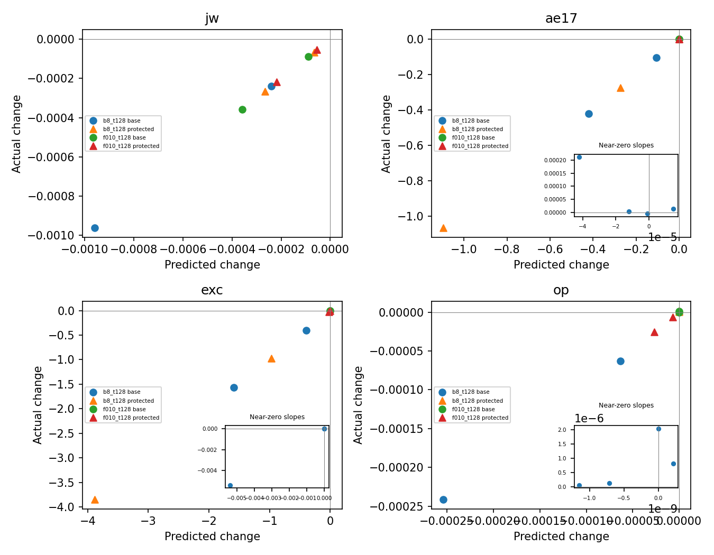

# F015 — S5-to-Lap chemistry, information and local attainability

## 1. Executive scientific conclusion

**PARTIAL — completed with documented evidence limitations. Primary classification A: local chemistry-objective/optimization bottleneck supported.**

B8 admits an executed-in-memory, historical-radius direction that lowers JW, AE17, Exc and the operator. Its aggregate chemistry gain sacrifices the four historically problematic databases. Protecting them sharply reduces progress and leaves small finite physical regressions. Thus aggregate progress does not imply balanced chemistry. This supports an optimization/objective-geometry mechanism locally; it does not establish that this mechanism explains the entire S5 gap.

S5 actively uses tau in both exchange-output and correlation-output pathways. Similar bounded Lap descriptors sometimes conceal substantial tau variation. This is measurable additional information, not a controlled demonstration that tau causes better chemical accuracy. The model-to-model comparison is confounded by weights, activation/anchors, training history/budget and potential supervision. No global Lap expressivity failure is established.

## 2. Provenance and comparability

Exact S5 selected checkpoint verified: `946d93f12656415288d4cb98b92183a203ad78fa13b57c8acaeef7ac5d1776de`; strict9542-parameter load. All five9446-parameter Lap checkpoints and reaction/physical-gradient caches matched F013 SHA receipts. Source revision: `07d21b2ec42a7bad9c630c1189eaa73b2d223839` (F014 preserved).

**251 canonical reaction identities matched exactly** to the accepted S5 evaluation population. Same source-group hash and exact equality of Grid (including original tau), densities, gradient invariants, signed weights, fixed non-XC/HF terms, coefficients, targets and splits against the accepted legacy Minnesota store. All models consume the same numerical inputs/corrections. Only27 identities share the old S5 audit variant, so historical S5 MAE6.11594 was not reused as a current baseline.

Independent qualified S5 forward replay across all8 databases: maximum error-reconstruction gap 1.784e-11 kcal/mol. All1255 Lap reaction predictions match their cached residuals within the predeclared1e-6 kcal/mol tolerance. Canonical parameter order is sorted unique names, not state_dict traversal; exact order/JW/eight database gradient checks passed.

**Limitation:** original DM, basis/charge/spin/geometry and spatial coordinates are not embedded in these grouped reaction records. For example `C:/Dev/ML-DFT/piNN-DFT/train_models/data/C2H6_abde4__level2.h5` is missing; the accepted grouped pickle is present but has only numerical reaction fields. Independent original-molecule reconstruction and genuine3D spatial maps are BLOCKED. This is a numerical-input-matched comparison, not a newly geometry/DM-certified benchmark. The S5 historical training-corpus identity is also unavailable.

Precision: source/checkpointF32 values widened to matchedF64 chemistry; native F64 dispersion scalars retained. F64 diagnostic algebra/input derivatives; actual finite evaluations retain F32 native parameters, repaired F64 learned operator branch, F32 PBE branch and F64 AO assembly. Widening does not recover lost source precision. Every chemistry evaluation uses exactly one fixed variant per identity. No exhaustive variant sweep.

## 3. S5 versus Lap chemistry

Reaction errors are kcal/mol. JW is `(1/251)sum |e_r|/A_d`, a training-only scalar; it is neither the legacy singleton mean nor GMTKN55 WTMAD-2. Eight-DB weighted RMSE below uses existing fixed `FCHEM_DB_WEIGHTS`, without renormalization.

| Model | MAE | RMSE | Median absolute error | JW | Legacy singleton mean | Eight-DB weighted RMSE | S5 wins/losses |
|---|---:|---:|---:|---:|---:|---:|---:|
| s5 | 6.117685 | 8.872701 | 3.835366 | 0.091002146 | 0.907187052 | 33.495367 | 0/0 |
| b8_t128 | 8.536568 | 12.262462 | 6.093131 | 0.156414638 | 1.195939284 | 44.536133 | 187/64 |
| f010_t128 | 7.441849 | 10.262653 | 5.366537 | 0.142369869 | 1.306406424 | 47.097621 | 166/85 |
| f010_t251 | 6.721172 | 9.242010 | 5.030102 | 0.135822095 | 1.342496612 | 47.552825 | 147/104 |
| f012_t128 | 7.776571 | 10.799167 | 5.661166 | 0.142494768 | 1.301020755 | 47.099470 | 173/78 |
| f012_t251 | 6.982328 | 9.633037 | 5.223441 | 0.136387893 | 1.324515628 | 47.174125 | 149/102 |

| Database | n | S5 MAE | B8 MAE | F010/t251 MAE |
|---|---:|---:|---:|---:|
| ABDE4 | 4 | 0.944642 | 3.000499 | 5.117739 |
| DBH76 | 70 | 3.991836 | 7.857969 | 6.826397 |
| EA13 | 11 | 3.236279 | 2.560592 | 3.892094 |
| IP13 | 13 | 3.343725 | 3.505517 | 2.999172 |
| MGAE109 | 104 | 10.242004 | 13.334307 | 9.068291 |
| NCCE31 | 28 | 0.531570 | 0.717074 | 0.567258 |
| PA8 | 8 | 1.608618 | 1.714795 | 3.897842 |
| pTC13 | 13 | 6.180228 | 6.639701 | 8.978835 |

S5 improves the B8 reaction-weighted MAE by2.418883 kcal/mol (28.34%), winning187/251 reactions. DBH76 and MGAE109 contribute about97.5% of that population-weighted gap; this is a contribution accounting, not a statement that larger databases are scientifically more important. Macro-average database MAE: S5=3.759863, B8=4.916307, F010/t251=5.168453. F010 improves population MAE while worsening this macro summary. At F010/t251 S5 still wins147/251 and has lower median error, but F010 is better on MGAE109 and IP13. S5 is not uniformly superior in every database; at B8 it is worse on EA13.

The signed/absolute distributions, p90/p95, error correlations, paired database wins and each reaction JW contribution are in the CSVs. Largest-error contributions can be reconstructed by sorting the recorded contributions; no reaction was discarded.

| Model | Matched AE17 atomic MAE (17, separate population) |
|---|---:|
| b8_t128 | 6.201029 |
| f010_t128 | 4.261918 |
| f010_t251 | 2.687273 |
| f012_t128 | 10.238198 |
| f012_t251 | 2.287902 |
| s5 | 15.204596 |

These source AE17 records have one coefficient+1 component and supervise absolute atomic energies, not relative reaction cancellation. Lap is substantially better on this atomic population even when S5 is better on relchem. Exact integrated XC reference energies for the Minnesota species are not available: per-species numbers are model-to-model XC differences, not exact XC errors. Fixed non-XC and dispersion differences are zero. Median reaction cancellation ratio `|sum coef*deltaExc|/sum |coef*deltaExc|` is0.035123 for B8/S5 and0.072919 for F010/t251/S5 (denominator floor1e-12 kcal/mol). Large individual model-energy differences cancel strongly; this does not prove either model has more accurate individual molecular XC energies.

## 4. Descriptor information and sensitivity

Full selected population:495 unique grids,23,231,999 points. Stride101 physical samples are used for sensitivities, never substituted for full energy integrals. Signed quadrature is preserved in energies; statistics use max(w,0) and max(w,0)*max(rho_total,0). Full per-grid/database/species statistics remain externally SHA-bound; compact and pooled tables are committed.

Exact Lap formulas: `n_sigma=(rho_sigma+1e-10)^(1/3)`; `s_i=(sqrt(sigma_i+1e-30)-sqrt(1e-30))/(2*(3*pi^2)^(1/3)*(rho_i+1e-10)^(4/3))`; `q_sigma=lap_sigma/(4*(3*pi^2)^(2/3)*(rho_sigma+1e-10)^(5/3))`; zeta=(rho_a-rho_b)/(rho_total+1e-10). tanh applies to n/s/q, not zeta. Exchange uses spin-scaled rho*2, sigma*4, lap*2 and consumes only(s_sigma,q_sigma). Correlation consumes all8 descriptors plus fused exchange features.

S5 uses10 correlation descriptors and exchange(s_sigma,alpha_sigma,q_sigma). It does not subtract the zero-sigma square-root regularizer in s. Its `alpha=clamp((tau-tauW)/tauTF-1,min=-1)` with tauW=sigma/(8*(rho+EPS_RHO)), C_TF=(3/10)*(3*pi^2)^(2/3). Correlation tauTF=0.5*C_TF*(2*rho_sigma+EPS_RHO)^(5/3); exchange tauTF=C_TF*(rho_scaled+EPS_RHO)^(5/3)+EPS_RHO, after rho/tau/lap*2 and sigma*4. Its q denominator matches the corresponding raw/spin-scaled convention. n/s/alpha/q are tanh-bounded and zeta is unchanged. These exact transformations are retained from NN_models.py. Lap never reads the tau columns. Gc activation differs too: Lap shiftedELU(z-1), S5 1-|z-1|. No transform or activation was replaced.

Correlation q_up saturation at |tanh(q)|>.95/.99/.999: unweighted51.84%/46.24%/42.27%, electron-weighted12.35%/6.15%/3.66%. Thus large point fractions are dominated by weak-density/volume regions. At rho>=1e-3, q_up>.99 covers5.40% of electrons. Any-spin correlation-q99 regions account for5.15% of absolute stoichiometry-weighted B8/S5 grid XC-difference mass. This gross fraction must NOT be used to dismiss chemical relevance: after signed integration and reaction cancellation, the sum of absolute q99 reaction contributions is 2.716919 times the sum of absolute total model-to-model reaction differences; their correlation is-0.586638. Saturated and nonsaturated contributions strongly cancel. The signed region decomposition is committed. This establishes important cancellation, not a causal saturation bottleneck. Actual tanh slopes, other generated density/gradient descriptors and both spin-scaled pathways are tabulated; generated n/s_total descriptors in the exchange path are not mistaken for consumed exchange inputs.

| Output channel, rho>=1e-3 | Lap mean dq norm | S5 mean dq norm | Lap mean tau-relative norm | S5 mean tau-relative norm |
|---|---:|---:|---:|---:|
| GNN_up (exchange output) | 0.015171 | 0.007900 | 0 | 0.053585 |
| Gc (correlation output) | 0.035987 | 0.031029 | 0 | 0.100945 |

All reported dq sensitivities use the canonical unscaled physical q_sigma=lap_sigma/[4*(3*pi^2)^(2/3)*(rho_sigma+EPS_RHO)^(5/3)], holding other raw inputs fixed. Exchange heads internally consume the spin-scaled q and their chain rule is included; these are not derivatives solely with respect to neural q_exchange while holding fused pathways fixed. Outputs are normalized by NN_OUTPUT_SCALE_PBE (GNN remains additive with unit scale). Tau-relative sensitivity is the norm of tau_sigma*dG/dtau_sigma; physical tau derivatives have inverse kinetic-density units and are separately tabulated. These are output-channel sensitivities, not isolated parameter-block gradients; normalization does not make their magnitudes a causal importance ratio. All24 selected input FD checks passed; Lap tau derivatives are exactly zero. Other learned beta/gamma/mu/kappa/spin outputs are retained in the full tables.

For50,000 deterministic physical samples at rho>=1e-3,9682 nearest-neighbour pairs have bounded8-dimensional Lap descriptor distance<=0.001. Their median normalized tau difference is0.005882, electron-weighted median0.000221, and9.15% of paired electron weight has normalized tau difference>0.1. At distance<=0.01 the corresponding tail is18.07%. Normalization is total TF tau with floor1e-12. This demonstrates a nonuniform conditional information tail, not a uniformly missing tau signal or an impossibility theorem. The stricter rho>=1e-6 analysis has very large unweighted tails but small electron-weighted medians; these are not hidden.

In q99 regions the S5 electron-weighted mean tau-relative sensitivity is0.143429 for GNN_up and0.080103 for Gc (Lap both0). Grid-region XC differences and these active channels are observational associations, not a tau-causal ablation. No off-manifold substitution was used as causal evidence; FD input perturbations are mathematical derivative checks only. Missing original geometry/coordinates prevents a verified atom/molecule spatial stratification of all relchem grids and genuine3D maps. The separate source-labelled AE17 atomic comparison does not silently relabel the mixed relchem grid pool.

## 5. Local Jacobian geometry

Reaction order, units(kcal/mol per parameter),251x9446 shape, finite values, sorted unique/tied parameter ordering and eight DB/JW gradient reconstruction passed. All8 selected live parameter JVPs passed against frozen-input F64 central differences. Raw AE17/Exc/operator gradients are reused without training coefficients.

| State | Rank @1e-8 | Ranks @1e-6 /1e-10 | Condition resolved | S5 difference projected squared fraction | Minimum-norm displacement | Displacement /r |
|---|---:|---:|---:|---:|---:|---:|
| b8_t128 | 239 | 137/249 | 9.603e+07 | 0.999995315 | 6155.889 | 9.473e+06 |
| f010_t128 | 240 | 137/249 | 9.914e+07 | 0.999996210 | 6236.048 | 9.596e+06 |
| f010_t251 | 240 | 137/249 | 9.516e+07 | 0.999996370 | 6068.519 | 9.338e+06 |
| f012_t128 | 239 | 137/249 | 9.347e+07 | 0.999995113 | 6045.512 | 9.303e+06 |

Nearly all of the numerical-input-matched S5 error difference projects into the resolved column space, but exact pattern matching requires wildly impractical linearized displacements. At B8 the displacement changes from280.88 to6155.89 to8843.85 across the frozen resolution thresholds; it is not a robust practical prescription. The inverse is ill-conditioned and all values exceed the trust radius. S5 is an orientation baseline, not a ground-truth teacher. Neither this local pseudoinverse nor numerical rank proves global architecture incapacity; reproducing S5 signed errors is not required to reduce true errors.

## 6. Physically constrained attainability

`W_rr=1/(251*A_d)` is fixed from training references; the probe minimizes0.5 sum W*(e+J*delta)^2, not JW. Radius fixed at0.0006498670299681904 for every state. Constraints use raw g_A/g_E/g_O. The economic QR span contains every J row and constraint direction without truncation; projection into it leaves objective/constraints unchanged and cannot increase norm. This is an equivalent reduced convex problem, not a new training algorithm.

SLSQP is independently certified by primal feasibility, nonnegative multipliers, stationarity and the convex Lagrangian dual bound. No constraint/radius was relaxed. All8 base/protected solves passed; maximum KKT residual1.30e-7, primal residual at roundoff, dual gap<4e-14. Conditioning/active constraints/multipliers are in external certificates. F64 arithmetic is used; threshold sensitivity is separately reported, not tuned.

| State | Base predicted weighted-LS reduction | Protected reduction | Progress lost by protecting4 DBs |
|---|---:|---:|---:|
| b8_t128 | 1.150332% | 0.250453% | 78.228% |
| f010_t128 | 0.569719% | 0.250263% | 56.073% |
| f010_t251 | 0.447029% | 0.233925% | 47.671% |
| f012_t128 | 0.633428% | 0.250136% | 60.511% |

All four states triggered exactly the predeclared protection solve for ABDE4/EA13/PA8/pTC13. Per-database MAE/RMSE predictions are in the tables. Protection is first-order no-worsening of the existing DB absolute-error objective (positive-scaled global contribution), not a guarantee about finite-step RMSE or every other DB. At B8 protected IP13 worsens: no extra constraint was added after inspection.

F013 context, reused: four-task /+problem4 /all8DB+physical normalized feasibility margins: B8=.801/.065/.012; F010/t128=.110/.110/.087; F010/t251=.0081/.0033/.0033; F012/t128=.077/.077/.056. Those max-min directions and this weighted-LS direction solve different problems.

## 7. Finite-step validation

Exactly8 probes at B8/F010t128, base/protected,0.25r/1r; no step-size search. Predictions below use the **actual rounded F32 displacement**, independently reconstructed on CPU and checked against saved norms/dots. Intended F64 solver slopes and relative rounding errors are in lap_f015_f32_rounding.csv. Parameters, buffers, RNG, spin symmetry, passthrough and UEG/high-density/rapid-gradient anchors restored/verified after every probe. Perturbed weights were never saved.

| State | Direction | Scale | Actual delta JW | Actual delta AE17 | Actual delta Exc | Actual delta operator | Strict all4 descent |
|---|---|---:|---:|---:|---:|---:|---|
| b8_t128 | base | 0.25 | -0.00024025012 | -0.105304478 | -0.398609691 | -6.26694647e-05 | True |
| b8_t128 | base | 1.0 | -0.000960968487 | -0.42032859 | -1.56614482 | -0.00024118303 | True |
| b8_t128 | protected | 0.25 | -6.64812632e-05 | -0.273817204 | -0.971923822 | +1.26709264e-07 | False |
| b8_t128 | protected | 1.0 | -0.000265870995 | -1.06415642 | -3.84646536 | +2.03878748e-06 | False |
| f010_t128 | base | 0.25 | -8.9481179e-05 | +1.44526202e-05 | -5.78737829e-06 | +4.9851508e-08 | False |
| f010_t128 | base | 1.0 | -0.000357887241 | -4.2119282e-06 | +5.56555222e-06 | +8.12281882e-07 | False |
| f010_t128 | protected | 0.25 | -5.47882351e-05 | +3.78455554e-06 | -0.00540546301 | -6.57718934e-06 | False |
| f010_t128 | protected | 1.0 | -0.000219159248 | +0.000211596763 | -0.0216285965 | -2.53677869e-05 | False |

B8 base at r lowers JW by0.61437%, AE17 by0.420329, Exc by1.566145 and operator by0.000241183. ABDE4/EA13/PA8/pTC13 MAEs simultaneously rise by0.08354/0.02534/0.09558/0.14238 kcal/mol. This is real aggregate progress with systematic DB sacrifice.

B8 protection reduces JW progress to0.000265871 while protecting the four small DBs, but operator rises by2.0388e-6 at r (0.00659% of baseline). At0.25r it already rises1.2671e-7. This is not strict finite common descent. F010 base has approximately neutral physical slopes: F32 addition can change their signs, and operator curvature remains positive. F010 protected at r lowers JW/Exc/operator but AE17 rises0.000211597 despite a rounded linear prediction-4.223e-5. That reversal is retained. The large F013 Exc reversal does not repeat at its former scale on these different QC directions; no universal curvature cure is inferred.

All160 metric rows retain prediction/realization/sign reversals, including eight DB MAE/RMSE summaries. F32 vector rounding changes the intended displacement by0.0786–0.3242% in relative vector norm; actual radius norms differ by-4.41e-6 to+4.14e-5 relatively. No compensating rescale or feasibility repair was applied. Boundary sign changes must be distinguished from broad failures: no arbitrary tolerance converts a positive objective change into a decrease. Intended F64 feasible directions and finite native-F32 protection are separate claims.

## 8. Supported mechanisms

- Aggregation trades off small databases; a lower population MAE/JW can worsen macro chemistry and legacy weighted RMSE.
- Useful local correction directions exist near B8 and survive finite steps; historical aggregate/AdamW directions need not use them (F013 context).
- Protecting the problematic databases costs substantial progress; rounding/curvature matters near active physical constraints.
- S5 uses additional tau information; bounded Lap descriptors compress some of that information, especially in a conditional tail.

## 9. Unsupported or unresolved mechanisms

No causal tau/activation ablation; no global Lap incapacity; no proof that saturation explains the gap; no assertion of exact individual molecular XC accuracy; no S5 physical operator score; no generalization/SCF-stability result. The full chemical gap cannot be assigned to one cause by comparing differently trained models. S5 correct energetics does not qualify its historical partial-density potential loss; a flawed potential loss does not automatically invalidate its energy functional.

## 10. Scientific limitations

Single Lap lineage; differing S5 architecture/weights/training budget/history; historical training-corpus identity missing; original geometry/basis/DM reconstruction blocked. Information statistics are deterministic correlated grid samples, not independent experiments. This is fixed-density training chemistry, not out-of-distribution validation. Mandatory background reports were read, including their historical development discussion; no development-score artifact entered F015 calculations or selection and no validation evaluator was called. Initial execution used the canonical bundle, which incidentally initializes validation metadata even on training access; therefore this audit does not claim that such metadata was never visible. The final isolated TrainingBundle guardrail excludes validation indices/labels and rejects validation access while retaining unchanged canonical training methods and source/shard checks. No future-test dataset or evaluation occurred.

Chemistry comparison recorded591.373s; finite probes total2603.584s. Every finite invocation is bounded and receipts are reused on resume. No training occurred.

## 11. One recommended next intervention

One read-only energy-consistent S5 generalized-KS AO-operator audit on the historical qualified15, including tau and Laplacian terms, subject to exact frozen density/orbital/tau provenance. No training, SCF, new references or partial-density-derivative proxy.

This is a separate, bounded physical-consistency diagnostic to determine whether S5 chemistry advantage coexists with correct operator supervision or exploits its weaker historical target. It is not a new optimizer/loss recommendation and was not started.

## 12. Reproducibility and artifact hashes

Run from lap_full_vxc with the qualified libxc Python environment: audit freeze; inputs chemistry; audit local/check; inputs descriptors/finite/atoms; render prepare/rounding/compact/plots/provenance. Frozen protocol is immutable; completed reaction/grid/finite receipts are reused. Complete per-grid tables and sampled derivative arrays stay in C:/Dev/readWFN_share_ms/lap_f015_audit_20261013, SHA-bound by lap_f015_provenance.json. Compact tables, nine data-backed plots, tests and scripts are committed; no checkpoints/raw molecular grids are committed.

Provenance records source revision, exact checkpoint/cache/source/artifact SHA256, Python/NumPy/Torch/CUDA/device. All original dataset/checkpoint/production-source pins reverified. Optimizer updates0; trainingNO. Final test/lint/compile/diff receipts are recorded in lap_f015_validation.json. F014 is preserved and the final response records local/remote commit confirmation.

